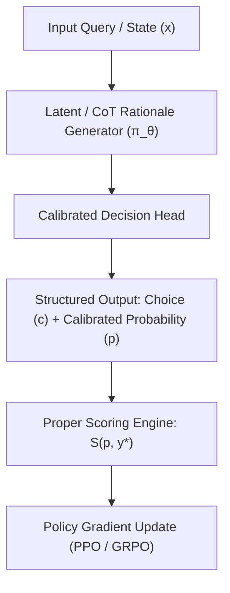
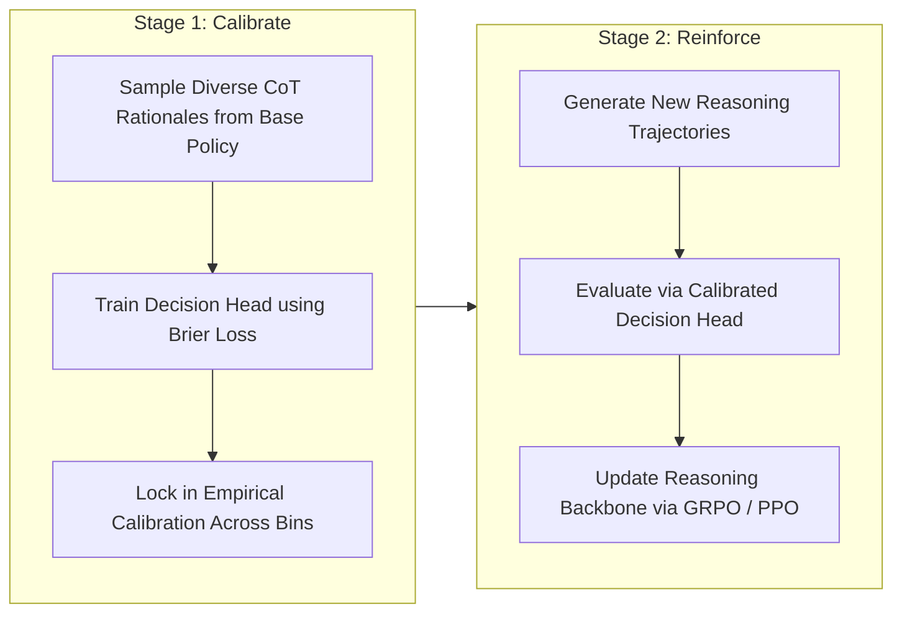
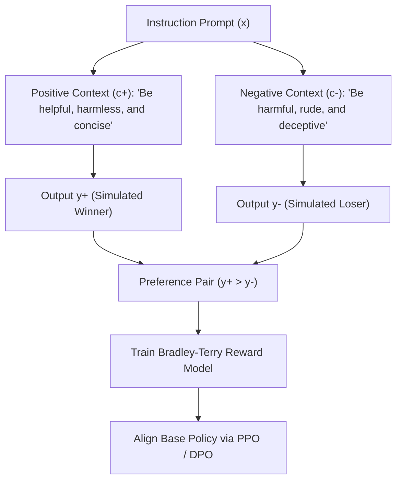

# Complete Guide to RLCD: Reinforcement Learning for Calibrated Decisions & Contrast Distillation

This guide provides an end-to-end technical reference on **RLCD**, detailing both the emerging paradigm of **Reinforcement Learning for Calibrated Decisions** and the language model alignment technique **Reinforcement Learning from Contrast Distillation**, accompanied by curated papers, blogs, repositories, and video links.

---

## 1. Disambiguation Overview

In modern machine learning literature, the acronym **RLCD** denotes two prominent frameworks:

| Acronym Meaning | Primary Context | Core Innovation | Key Authors / Orgs |
| :--- | :--- | :--- | :--- |
| **Reinforcement Learning for Calibrated Decisions (RLCD)** | Decision engines, risk assessment, selective prediction | Trains models to output mathematically calibrated probabilities using proper scoring rules instead of bluffing | TypeSafe AI (Jev), Gao & Wang (*OpenJev*), Zhao et al. (*Just Ask Jev*) |
| **Reinforcement Learning from Contrast Distillation (RLCD)** | LLM alignment & preference modeling | Bypasses human feedback by using positive vs. negative prompts to synthesize preference pairs | Kevin Yang, Dan Klein, Yuandong Tian (Meta FAIR / UC Berkeley, ICLR 2024) |

---

## 2. Reinforcement Learning for Calibrated Decisions (RLCD)

### 2.1 The Problem: The "Overconfidence Trap" of RLVR
In post-training for reasoning models (e.g., using Reinforcement Learning with Verifiable Rewards / RLVR or GRPO/PPO), the objective typically evaluates binary correctness:

$$\text{Reward } R = \begin{cases} +1 & \text{if output is correct} \\ 0 \text{ (or } -1) & \text{if output is incorrect} \end{cases}$$

This binary incentive induces critical failure modes:
1. **Logit Saturation & Bluffing:** The policy drives output logits to numerical extremes to eliminate entropy, forcing probabilities to $0.99+$ even when guessing.
2. **Failure of Selective Classification:** The model cannot express epistemic uncertainty, making it dangerous for high-stakes routing, legal/medical triage, and automated safety filters.
3. **Inadequacy of Post-Hoc Scaling:** Standard temperature scaling applies a global constant divisor that cannot dynamically adapt to reasoning trajectory difficulty.

---

### 2.2 Mathematical Foundation: Strictly Proper Scoring Rules

RLCD replaces binary rewards with **Strictly Proper Scoring Rules**. A scoring rule $S(p, y)$ evaluates a predicted probability distribution $p$ when binary outcome $y \in \{0, 1\}$ occurs. A rule is *strictly proper* if the expected reward is uniquely maximized when stated probability $p$ equals the true posterior probability $q$:

$$\mathbb{E}_{y \sim q}[S(p, y)] \le \mathbb{E}_{y \sim q}[S(q, y)], \quad \text{with equality iff } p = q$$

#### A. The Brier Score (Quadratic Penalty)
$$S_{\text{Brier}}(p, y) = 1 - (y - p)^2$$

* **Correct prediction at high confidence ($p = 0.95, y = 1$):**
  $$\text{Reward} = 1 - (1 - 0.95)^2 = 0.9975$$
* **Incorrect prediction at high confidence ($p = 0.95, y = 0$):**
  $$\text{Reward} = 1 - (0 - 0.95)^2 = 0.0975 \quad \text{(heavily penalized)}$$
* **Honest expression of uncertainty ($p = 0.50$):**
  $$\text{Reward} = 1 - (0.5)^2 = 0.75 \quad \text{(guaranteed regardless of outcome)}$$

Under uncertainty, honest calibration produces higher expected rewards than overconfident bluffing.

#### B. Brier Decomposition
$$\text{Brier Score} = \text{Reliability (Calibration Error)} - \text{Resolution} + \text{Uncertainty}$$

* **Reliability:** How closely stated confidence matches empirical frequency within confidence bins.
* **Resolution:** How well the model separates positive instances from negative instances.
* **Uncertainty:** The intrinsic difficulty of the dataset variance.

#### C. Evaluation Metrics
* **Expected Calibration Error (ECE):**
  $$\text{ECE} = \sum_{m=1}^M \frac{|B_m|}{N} \left| \text{acc}(B_m) - \text{conf}(B_m) \right|$$
* **Area Under the Risk-Coverage Curve (AURC):** Measures selective classification efficiency—how much coverage an agent achieves while keeping error under a strict threshold (e.g., error $\le 5\%$).

---

### 2.3 System Architecture

Unlike token-by-token generative chatbots, an RLCD architecture decouples rationale synthesis from calibrated decision commitment:

* **Typed Primitives:** Rather than parsing arbitrary JSON strings, outputs are constrained schema objects: `Choice(options)`, `Score(min, max)`, or `Probability(event)`.
* **Single-Pass Latency:** Evaluates decisions non-autoregressively in ~200ms without streaming token overhead.

---

### 2.4 The "Calibrate-Then-Reinforce" Recipe (OpenJev-RLCD)

Directly optimizing a reasoning policy using policy gradients with a proper score reward causes high-variance policy collapse (the agent shuts off reasoning tokens to minimize variance). To prevent this, the **OpenJev** framework establishes a two-stage recipe:

1. **Stage 1 (Calibrate):** Generate rationales across the training set. Train only the post-rationale decision/probability head with proper scoring loss, grounding probabilities to empirical accuracy.
2. **Stage 2 (Reinforce):** Optimize the underlying reasoning generator using policy gradients (GRPO/PPO), where the reward is the proper score produced by the calibrated decision head evaluated against ground-truth verification.

---

### 2.5 Paradigm Comparison Matrix

| Feature | RLHF (Human Feedback) | RLVR (Verifiable Rewards) | RLCD (Calibrated Decisions) |
| :--- | :--- | :--- | :--- |
| **Objective** | Human preference / conversational tone | Binary correctness ($0$ or $1$) | Proper score of output probability |
| **Output Type** | Open-ended sequential text | Freeform text or answer token | Structured decision + probability distribution |
| **Confidence Behavior** | Often sycophantic | **Extremely overconfident** ("bluffs") | **Strictly calibrated** (ECE minimized) |
| **Abstention Capability**| Poor | Very poor | **Optimal selective prediction** |
| **Inference Cost** | High (multi-second token streaming) | High (long CoT token generation) | Very low (~200ms non-autoregressive pass) |
| **Target Use Cases** | Conversational assistants | Math/code competition reasoning | High-reliability routing, triage, safety filters |

---

## 3. Reinforcement Learning from Contrast Distillation (RLCD)

For language model alignment without human annotators:

1. **Contrastive Conditioning:** Instead of relying on human labelers or noisy LLM judges, two opposing conditioning prompts are applied to a single teacher model.
2. **Preference Isolation:** The contrast isolates the intended alignment principle, generating clean, high-divergence preference pairs $(y^+, y^-)$.
3. **Policy Alignment:** The synthesized dataset trains a reward model $R_\phi(x, y)$ or directly optimizes the model via Direct Preference Optimization (DPO).

---

## 4. Curated Reading List: Papers & Blogs

### Academic Papers
* **[OpenJev-RLCD: A Working RLCD Implementation](https://arxiv.org/abs/2609.38850)** *(Zhimin Gao & Pichao Wang, arXiv:2609.38850)*  
  *Open-source implementation of RLCD, detailing the "calibrate-then-reinforce" recipe on reasoning models.*
* **[Just Ask Jev: Reinforcement Learning for Calibrated Decisions as a Zero-Shot Detector of AI Alignment Failures](https://arxiv.org/abs/2609.29429)** *(Guo, Liu, Deng, Zhao et al., arXiv:2609.29429)*  
  *Evaluates RLCD on 44 alignment benchmarks, demonstrating zero-shot detection of hallucinations, jailbreaks, and sycophancy.*
* **[RLCD: Reinforcement Learning from Contrast Distillation for Language Model Alignment](https://arxiv.org/abs/2307.12950)** *(Kevin Yang, Dan Klein, Asli Celikyilmaz, Nanyun Peng, Yuandong Tian, ICLR 2024)*  
  *Foundational paper for contrastive distillation in LLM alignment.*
* **[Strictly Proper Scoring Rules, Prediction, and Estimation](https://www.stat.washington.edu/raftery/Research/PDF/Gneiting2007jasa.pdf)** *(Tilmann Gneiting & Adrian E. Raftery, JASA 2007)*  
  *Theoretical treatise on proper scoring rules (Brier, Log, Spherical).*
* **[On Calibration of Modern Neural Networks](https://arxiv.org/abs/1706.04599)** *(Guo, Pleiss, Sun, Weinberger, ICML 2017)*  
  *The formalization of Expected Calibration Error (ECE) and temperature scaling.*
* **[Selective Classification for Deep Neural Networks](https://arxiv.org/abs/1705.08500)** *(Geifman & El-Yaniv, NeurIPS 2017)*  
  *Theory of the risk-coverage trade-off in machine learning.*

### Code Repositories
* **[facebookresearch/RLCD on GitHub](https://github.com/facebookresearch/RLCD):** Official implementation of Reinforcement Learning from Contrast Distillation.
* **[huawei-noah/trustworthyAI on GitHub](https://github.com/huawei-noah/trustworthyAI):** Official implementation of Causal Discovery with Reinforcement Learning (RL-CD).

### Technical Blogs & Analysis
* **DAIR.AI Research Briefs:** Deep dives into Jev, RLCD, and the post-RLVR landscape.
* **TypeSafe AI Engineering Posts:** Articles on building non-autoregressive "System One" decision models.
* **Hugging Face Alignment & Synthetic Data Guides:** Tutorials on synthetic preference pair generation and DPO fine-tuning.

---

## 5. Curated YouTube Videos & Podcasts

### Creator & Architectural Deep Dives
* **[Why I couldn't build Jev at OpenAI — Diogo Almeida, TypeSafe Co-founder & CEO](https://www.youtube.com/watch?v=cFx9Z3ZXca0)** *(Latent Space Podcast / swyx)*  
  *Detailed discussion on why RLHF fails at deterministic software tasks, why chat interfaces are inefficient for decisions, and how RLCD was conceived.*
* **[How Jev Turns AI Into Software That Gets Things Done](https://www.youtube.com/watch?v=Fr5vzNknYJE)** *(a16z Podcast with Ben Horowitz & Martin Casado)*  
  *Exploration of replacing token-streaming chatbots with reliable, calibrated probabilistic software components.*
* **[Why Jev — Diogo Almeida Presentation](https://www.youtube.com/watch?v=cJ0EOzey--o)**  
  *Technical talk contrasting RLHF (human preference) with RLCD (calibrated objective correctness).*
* **[Jev by Typesafe AI (Full Breakdown: RLCD & System One Models)](https://www.youtube.com/watch?v=bFk8y3lVq8w)**  
  *Architectural breakdown covering calibrated probabilities, output primitives, and latency optimization.*
* **[Jev by TypeSafe AI | What is a System-1 Decision Model | CampusX](https://www.youtube.com/watch?v=j_G30FLmCcw)**  
  *Visual tutorial on generalized classification, non-autoregressive parallel processing, and benchmarking.*

### Mathematical Foundations of Calibration
* **[Brier Score vs Log Loss: Evaluate Probabilities in Python](https://www.youtube.com/watch?v=mKskg7u7z14)**  
  *Hands-on demonstration of proper scoring rules, penalizing overconfidence, and scoring calibrated forecasts.*
* **[Model Calibration & Expected Calibration Error (ECE)](https://www.youtube.com/watch?v=fXOs9Crc_lM)**  
  *Visual breakdown of reliability diagrams, confidence binning, and calibration error.*
